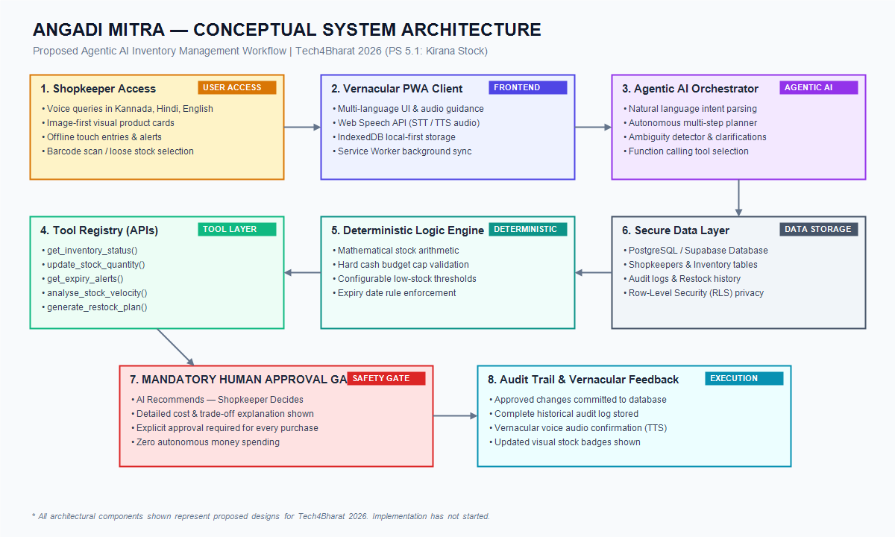

# 🏪 Angadi Mitra

> **Making everyday kirana management simpler through technology.**

[](https://thegavshackathon.com)
[](https://thegavshackathon.com/docs/Tech4Bharat-2026-Problem-Statements.pdf)
[](https://thegavshackathon.com)
[](#-agentic-ai-vs-traditional-chatbots)
[](docs/project_status.md)

---

## ⚡ 2-Minute Executive Overview

**Angadi Mitra** ("Shop Friend") is a proposed multilingual, image-first, voice-assisted **Agentic AI** inventory management assistant designed for small and village-level kirana (provision) stores across India.

Unlike traditional retail ERP or billing applications, Angadi Mitra requires **no prior billing history**, works on **entry-level Android smartphones**, operates **offline-first**, and allows shopkeepers to interact using **natural spoken Indian languages** (e.g., Kannada, Hindi, Tamil, Telugu).

```
Shopkeeper Speaks (Kannada/Hindi)  ──>  Agentic AI Analyzes Inventory  ──>  Shopkeeper Approves
"10 packets of biscuits arrived"        Checks budget & expiry risks        AI Recommends, Human Decides
```

### 🎯 Key Highlights
- **Voice & Vernacular Accessibility:** Shopkeepers speak naturally; the AI updates stock and replies with spoken vernacular feedback.
- **Image-First Visual Dashboard:** High-contrast product imagery with local-language names instead of complex tables or SKUs.
- **Zero-Data 7-Day Start:** Progressive onboarding delivers actionable restocking insights within the first week without legacy invoices.
- **Budget-Aware Restocking:** Purchase recommendations strictly respect the shopkeeper's cash-on-hand budget.
- **Mandatory Human Approval Gate:** The AI **never** commits money or places orders autonomously. Shopkeeper confirms every action.
- **Target Geography:** India-wide initiative supporting multiple Indian languages (not limited to any single state).

---

## 📋 Hackathon Alignment

| Parameter | Official Specification |
|---|---|
| **Hackathon** | Tech4Bharat 2026 – JanAI Mass Entrepreneurship Challenge |
| **Problem Statement** | PS 5.1 – Kirana Stock |
| **Theme** | Theme 5 – Rural FMCG & Logistics |
| **Approach** | Agentic AI (Goal-directed planning, tool calling, human approval) |
| **Primary Users** | Small, independent, and village-level kirana / provision store owners |
| **Project Repository** | [https://github.com/nithyashree94486-code/angadi-mitra](https://github.com/nithyashree94486-code/angadi-mitra) |

---

## 🛒 The Problem: Invisible but Costly Kirana Friction

Over 12 million small kirana stores across rural and semi-urban India manage stock purely through memory and manual shelf checks. According to the official Tech4Bharat PS 5.1 brief:

- 🔴 **Fast-Moving Stockouts:** High-velocity staples run out of stock unnoticed, resulting in immediate lost sales.
- 🔴 **Dead Stock Locks Working Capital:** Approximately **15–20% of scarce working capital** is trapped in non-moving stock.
- 🔴 **Stock Expiry Losses:** Perishables spoil on shelves, causing **₹5,000–₹10,000 in monthly losses** per store.
- 🔴 **Distributor-Driven Purchasing:** Restocking decisions are dictated by visiting distributor sales quotas rather than shop demand.
- 🔴 **Digital Literacy & Modality Barriers:** Complex accounting and billing apps alienate first-time digital users.

---

## 💡 The Solution: Angadi Mitra

Angadi Mitra provides a simple, intelligent assistant tailored to the realities of a village counter:

```
┌────────────────────────────────────────────────────────────────────────┐
│                        ANGADI MITRA USER JOURNEY                       │
│                                                                        │
│  [1. Select Language] ──> [2. Visual Dashboard] ──> [3. Voice Update]  │
│   Kannada, Hindi, etc.     Product cards & photos    "5 soaps arrived" │
│            │                         │                       │         │
│            ▼                         ▼                       ▼         │
│  [4. Low-Stock Alert] ──> [5. Restock Plan]     ──> [6. Shopkeeper Tap]│
│   Visual warning badge     Budget-capped (₹2,500)    Approves update   │
└────────────────────────────────────────────────────────────────────────┘
```

---

## 🏛️ Conceptual System Architecture

The proposed system enforces a clean separation between **conversational reasoning**, **deterministic business logic**, and **human approval**:



```
Shopkeeper (Voice/Touch) ──> Vernacular PWA Client ──> Agentic AI Orchestrator
                                                              │
                                            ┌─────────────────┴─────────────────┐
                                            ▼                                   ▼
                                    Tool APIs (Inventory)              Deterministic Logic
                                 (get_stock, check_budget)           (Exact arithmetic & budget)
                                            │                                   │
                                            └─────────────────┬─────────────────┘
                                                              ▼
                                               MANDATORY HUMAN APPROVAL GATE
                                              "AI Recommends — You Decide"
                                                              │
                                                              ▼
                                                 PostgreSQL / Local Cache
```

*For detailed architectural specifications, data schemas, and sequence flows, see [Solution Architecture](docs/solution_architecture.md).*

---

## 🤖 Agentic AI vs. Traditional Chatbots

Angadi Mitra is built as an **Agentic AI** system, not a simple conversational bot:

| Capability | Simple Chatbot | Angadi Mitra Agentic AI |
|---|---|---|
| **Action Execution** | Returns text only | Calls verified tools (`get_inventory`, `check_budget`) |
| **Financial Calculations** | May hallucinate arithmetic | Strictly offloaded to deterministic TypeScript logic |
| **Multi-Step Planning** | Single-turn Q&A | Chains multi-step workflows (gather data → evaluate → plan) |
| **Ambiguity Handling** | Guesses or gives generic reply | Asks clarifying questions (e.g., *"Which biscuit brand?"*) |
| **Safety & Autonomy** | Autonomous or unconstrained | **Mandatory Human Approval Gate** for all state changes |

*Explore the complete agent loop and tool registry in [Agentic AI Workflow](docs/agentic_ai_workflow.md).*

---

## ✨ Core Feature Matrix

| Category | Proposed Feature | What It Does for the Shopkeeper |
|---|---|---|
| **Accessibility** | 🌐 Multilingual UI | Works in Kannada, Hindi, English, and other Indian languages |
| **Accessibility** | 🎙️ Voice Interaction | Natural speech commands and vernacular audio summaries |
| **Accessibility** | 🖼️ Image-First Cards | Visual identification via product photos, not alphanumeric SKUs |
| **Inventory** | 📦 Conversational Updates | Say *"Five soaps arrived"* to record intake with one tap |
| **Inventory** | 🚚 Distributor Intake | Rapid receiving workflow for multi-carton deliveries |
| **Inventory** | ⚠️ Proactive Warnings | Clear visual and audio alerts for low-stock and out-of-stock items |
| **Intelligence** | 📅 Expiry Tracking | Alerts for items nearing expiration to reduce shelf wastage |
| **Intelligence** | 🐌 Dead-Stock Detection | Identifies slow-moving products locking working capital |
| **Intelligence** | 🚀 Fast-Moving Velocity | Tracks high-turnover items to prevent stockouts |
| **Intelligence** | 💵 Budget-Aware Restocking | Generates purchase recommendations strictly capped at cash budget |
| **Operation** | 📱 Offline-First PWA | Full operational continuity during rural cellular dropouts |

*Read the detailed breakdown of all capabilities in [Proposed Features](docs/features.md).*

---

## 🛠️ Technology Approach (Evaluated Candidates)

> *The technologies below represent thoroughly researched candidate options for prototype engineering. No live code or software packages are deployed at this documentation stage.*

- **Client Tier:** React + TypeScript + Vite Progressive Web App (PWA) with Tailwind CSS and shadcn/ui.
- **Offline Storage:** IndexedDB via Dexie.js with Service Worker synchronization.
- **Backend & Database:** Supabase (PostgreSQL with Row-Level Security for multi-tenant shopkeeper privacy).
- **Agentic AI Engine:** Google Gemini (evaluating gemini-3.8-flash) utilizing Function Calling for tool orchestration.
- **Speech Technologies:** W3C Web Speech API (device-native) with fallback to Google Cloud Speech-to-Text & Text-to-Speech (verified support across 8+ Indian languages).

*Full technology tradeoffs and research references are documented in [Technology Stack](docs/technology_stack.md).*

---

## 📊 Market Landscape & Differentiation

Existing market solutions do not address the small village kirana shopkeeper's reality:

```
┌────────────────────────────────────────────────────────────────────────┐
│                        COMPETITIVE POSITIONING                         │
│                                                                        │
│   Enterprise / Desktop ──> Marg ERP, GoFrugal (Complex, expensive)    │
│   Urban Billing Apps   ──> Vyapar, myBillBook (Requires invoice entry) │
│   Credit Ledgers       ──> Khatabook (Only tracks customer debt)       │
│                                                                        │
│   ANGADI MITRA         ──> Village-First, Voice-First, Image-First,    │
│                            Agentic AI Restocking with Budget Cap      │
└────────────────────────────────────────────────────────────────────────┘
```

*For structured competitor comparisons and verified citations, see [Competitor Analysis](docs/competitor_analysis.md).*

---

## 📚 Complete Project Documentation Index

All technical, product, and architectural documentation is organized inside the [`docs/`](docs/) directory:

| Document | Focus & Content |
|---|---|
| 📄 **[Solution Overview](docs/solution_overview.md)** | Problem narrative, target persona, zero-data onboarding, and design philosophy |
| 🔍 **[Problem Statement Analysis](docs/problem_statement_analysis.md)** | Verbatim requirements extraction from official PS 5.1 and Theme 5 brief |
| 🗺️ **[Requirements Traceability](docs/requirements_traceability.md)** | Comprehensive matrix mapping official challenge requirements to proposed features |
| 🌟 **[Proposed Features](docs/features.md)** | In-depth breakdown of Accessibility, Inventory, Intelligence, and Supporting capabilities |
| 🤖 **[Agentic AI Workflow](docs/agentic_ai_workflow.md)** | Agent loop, tool definitions, confidence thresholds, and human-in-the-loop safeguards |
| 🏛️ **[Solution Architecture](docs/solution_architecture.md)** | System layers, database schema, offline sync, security, and sequence diagrams |
| ⚙️ **[Technology Stack](docs/technology_stack.md)** | Evaluated frontend, backend, speech, and AI technologies with selection rationales |
| 📊 **[Competitor Analysis](docs/competitor_analysis.md)** | Verified benchmark against Vyapar, myBillBook, Khatabook, GoFrugal, Marg, BharatPe |
| 📖 **[Research & References](docs/research_and_references.md)** | Full citation index of official documents, speech APIs, and competitor sources |
| 📋 **[Field Validation Plan](docs/field_validation_plan.md)** | Non-fabricated shopkeeper interview questionnaire, observation checklist, and ethics protocol |
| 💼 **[Business Model](docs/business_model.md)** | Freemium structure, Pro tier rationale, distributor insights, and sustainability hypotheses |
| 👥 **[Team & Contributors](docs/team.md)** | Official contributor profiles and collaborative roles |
| 🚦 **[Project Status](docs/project_status.md)** | Clear categorization of verified completed work vs. proposed vs. future scope |
| 🎤 **[Presentation Pitch Content](docs/presentation_content.md)** | 9-slide competition pitch outline with visual suggestions and verbatim speaker notes |
| 🛣️ **[Implementation Roadmap](docs/implementation_roadmap.md)** | 6-week progressive prototype development plan and risk mitigation register |
| 📝 **[Submission Descriptions](docs/submission_descriptions.md)** | Concise portal-ready brief and detailed project submission summaries |

---

## 👥 Contributors

The Angadi Mitra project is collaboratively researched and authored for Tech4Bharat 2026 by:

- **Nithyashree H L** — [https://github.com/nithyashree94486-code](https://github.com/nithyashree94486-code)
- **Pooja Achar** — [https://github.com/pooja132a79450](https://github.com/pooja132a79450)

*Both members are recognized equally as core contributors. Detailed team information is available in [`docs/team.md`](docs/team.md).*

---

## 🚦 Current Status & Ethical Disclaimers

- 📌 **Documentation Phase:** This repository currently represents a comprehensive project documentation and architectural design portfolio for the Tech4Bharat 2026 hackathon evaluation stage.
- 📌 **No Implemented Software:** In accordance with project instructions, no live software prototype, interactive frontend, or database instances are currently deployed.
- 📌 **Unfabricated Research:** All field validation questionnaires and business model revenue streams are proposed methodologies; no live interviews or commercial transactions have been conducted yet.
- 📌 **AI Forecasting Labeling:** All predictive demand and seasonal insights are designed as assistive estimates, not guaranteed sales predictions.
- 📌 **Financial Safety:** The system is strictly engineered around human consent: **AI Recommends. The Shopkeeper Decides.**
