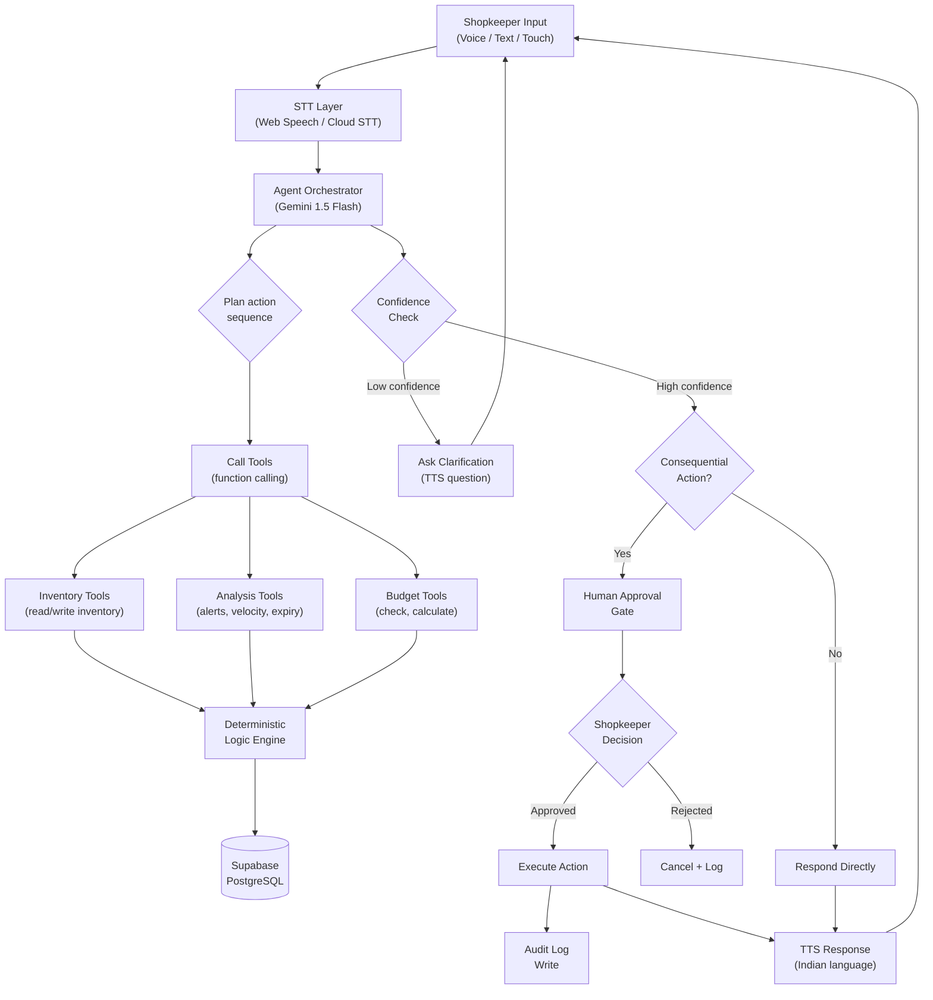

# Agentic AI Workflow — Angadi Mitra

> **Status:** Proposed design — not yet implemented.
> **Last updated:** November 2026

---

## 1. What Makes This Truly Agentic AI

A simple chatbot takes input, calls an LLM, and returns a response. That is **not** what Angadi Mitra does.

Angadi Mitra implements a **genuine agentic workflow** where:
- The LLM (Gemini) can call real tools to fetch and update data
- The agent plans multi-step sequences of actions
- The agent asks clarifying questions when uncertain
- The agent explains its reasoning before acting
- **No consequential action happens without shopkeeper approval**
- All actions are logged in an audit trail

---

## 2. The Agent Loop

```
┌─────────────────────────────────────────────────┐
│              AGENT EXECUTION LOOP               │
│                                                 │
│  1. Receive input (voice transcript or text)   │
│           ↓                                     │
│  2. Understand intent (LLM)                    │
│           ↓                                     │
│  3. Plan action sequence (LLM)                 │
│           ↓                                     │
│  4. Call tools (LLM selects, system executes)  │
│           ↓                                     │
│  5. Evaluate results                            │
│           ↓                                     │
│  6. Need more info? → Ask shopkeeper           │
│           ↓                                     │
│  7. Consequential action? → Request approval   │
│           ↓                                     │
│  8. Execute approved action                     │
│           ↓                                     │
│  9. Respond in shopkeeper's language (TTS)     │
│           ↓                                     │
│  10. Log action in audit trail                 │
└─────────────────────────────────────────────────┘
```

---

## 3. Tool Registry (Proposed)

The agent has access to these tools (functions it can call):

### 3.1 Inventory Tools

```typescript
// Get current inventory status
get_inventory_status(shopkeeper_id: string, filters?: {
  category?: string,
  low_stock_only?: boolean,
  out_of_stock_only?: boolean
}) → InventoryItem[]

// Update stock quantity (requires confirmation before calling)
update_stock_quantity(shopkeeper_id: string, item_id: string, {
  new_quantity: number,
  reason: string,           // 'sale' | 'purchase' | 'manual_correction'
  source: string            // 'voice' | 'manual' | 'barcode'
}) → StockMovementRecord

// Find product by name, alias, or barcode
find_product(query: string, language: string) → ProductMatch[]

// Record incoming stock from distributor
record_distributor_delivery(shopkeeper_id: string, items: DeliveryItem[]) → DeliveryRecord
```

### 3.2 Analysis Tools

```typescript
// Identify low-stock products
get_low_stock_alerts(shopkeeper_id: string) → Alert[]

// Identify products nearing expiry
get_expiry_alerts(shopkeeper_id: string, days_ahead: number) → Alert[]

// Identify dead/slow-moving stock
get_slow_moving_stock(shopkeeper_id: string, days: number) → SlowMoverReport[]

// Identify fast-moving products
get_fast_moving_stock(shopkeeper_id: string, days: number) → FastMoverReport[]

// Analyse stock velocity for a product
analyse_stock_velocity(shopkeeper_id: string, item_id: string) → VelocityReport
```

### 3.3 Budget and Purchasing Tools

```typescript
// Check available budget headroom
check_budget_headroom(shopkeeper_id: string, proposed_spend: number) → BudgetCheck

// Generate restocking recommendation (AI-assisted)
generate_restock_plan(shopkeeper_id: string, budget_limit: number) → RestockPlan

// Calculate total cost of a proposed purchase list
calculate_purchase_total(items: PurchaseItem[]) → PurchaseSummary
```

### 3.4 Communication Tools

```typescript
// Ask shopkeeper a clarifying question
ask_clarification(question: string, options?: string[]) → ShopkeeperResponse

// Request approval for an action
request_approval(action_description: string, impact_summary: string) → ApprovalResponse

// Send alert or notification
send_alert(shopkeeper_id: string, alert_type: string, message: string) → void
```

---

## 4. Example Agent Interactions

### Example A: Voice Stock Update

**Input (Kannada):** "ಹತ್ತು ಬಿಸ್ಕೆಟ್ ಪ್ಯಾಕೆಟ್ ಬಂತು" (Ten biscuit packets arrived)

```
Agent Step 1: Understand intent
  → Intent: "record_incoming_stock"
  → Product: "biscuit" (needs disambiguation)
  → Quantity: 10

Agent Step 2: Call find_product("ಬಿಸ್ಕೆಟ್", "kn")
  → Returns: [Parle-G 100g, Britannia Good Day, Generic Biscuit]
  → Confidence: Medium (multiple matches)

Agent Step 3: Ask clarification
  → "Which biscuits arrived? (Show images: Parle-G / Good Day / Other)"
  → Shopkeeper selects: Parle-G

Agent Step 4: Call get_inventory_status for Parle-G
  → Current quantity: 5 packets

Agent Step 5: Plan update
  → New quantity: 5 + 10 = 15 packets
  → Source: voice + visual confirmation

Agent Step 6: Request approval
  → "Shall I add 10 packets of Parle-G? Stock will go from 5 to 15 packets."
  → Shopkeeper confirms: Yes

Agent Step 7: Call update_stock_quantity(...)
  → quantity: 15, reason: 'purchase', source: 'voice'

Agent Step 8: Respond (TTS in Kannada)
  → "ಪಾರ್ಲೆ-ಜಿ ಸ್ಟಾಕ್ 15 ಪ್ಯಾಕೆಟ್‌ಗೆ ಅಪ್‌ಡೇಟ್ ಆಗಿದೆ" (Parle-G stock updated to 15 packets)

Agent Step 9: Log to audit trail
  → agent_actions: { intent: 'record_incoming_stock', tool: 'update_stock_quantity',
                     approval_required: true, approval_given: true, ... }
```

---

### Example B: Restocking Recommendation

**Input:** "What should I buy this week? I have ₹3,000."

```
Agent Step 1: Understand intent
  → Intent: "generate_restock_plan"
  → Budget: ₹3,000

Agent Step 2: Gather context (parallel tool calls)
  → get_low_stock_alerts()          → 5 items low
  → get_expiry_alerts(days=7)       → 2 items expiring soon
  → get_fast_moving_stock(days=14)  → 3 high-velocity items
  → get_slow_moving_stock(days=30)  → 4 slow movers

Agent Step 3: Call generate_restock_plan(budget=3000)
  → LLM analyses all data
  → Builds prioritised purchase list
  → Calculates estimated costs (using recorded purchase prices)
  → Total estimated: ₹2,840

Agent Step 4: Call check_budget_headroom(proposed_spend=2840)
  → Within budget: Yes (₹160 headroom)

Agent Step 5: Prepare recommendation with explanations
  → "Here is what I suggest this week (estimated total: ₹2,840):"
  →  1. Parle-G biscuits × 24 (stock: 2, sold 18 last 2 weeks) — ₹240
  →  2. Tata Salt × 10 (stock: 1, daily essential) — ₹120
  →  3. Surf Excel 500g × 6 (nearing low threshold) — ₹480
  →  ... (continue for all items)
  → "These 3 items are selling slowly — not recommended this week: [list]"

Agent Step 6: Request approval
  → Show full list with costs
  → "Total: ₹2,840. Shall I save this as your restocking plan?"
  → Note: "This is a suggestion — quantities and prices are estimates."

Agent Step 7: Shopkeeper approves / modifies
  → If approved: save to restock_recommendations table
  → If modified: update quantities, recalculate, re-confirm

Agent Step 8: Respond with confirmation (TTS)

Agent Step 9: Log full recommendation and approval to audit trail
```

---

### Example C: Expiry Alert Handling

**Automatic trigger:** Daily background check at opening time

```
Agent Step 1: Call get_expiry_alerts(shopkeeper_id, days_ahead=7)
  → Returns: Tomato Ketchup (expires in 3 days), 4 bottles

Agent Step 2: Assess urgency
  → 3 days is high urgency

Agent Step 3: Compose alert (in shopkeeper's language)
  → "⚠️ टमाटर केचप की 4 बोतलें 3 दिन में expire हो जाएंगी।
     उन्हें आगे रखें और जल्दी बेचने की कोशिश करें।"

Agent Step 4: Send alert notification

Agent Step 5: Log alert in agent_actions
```

---

## 5. Confidence and Uncertainty Handling

The agent should never silently make a wrong assumption.

| Situation | Agent Behaviour |
|---|---|
| Product name is unambiguous | Proceed with confirmation screen |
| Product name matches multiple items | Show image grid, ask shopkeeper to pick |
| Quantity is unclear ("some", "a few") | Ask for exact number |
| Price data not available | Acknowledge and ask shopkeeper |
| Forecast is based on <7 days data | Label as "early estimate — more data improves accuracy" |
| Budget would be exceeded | Show warning, suggest reduced list |
| Offline (no AI available) | Use cached rules, queue for AI analysis when back online |

---

## 6. What the LLM Does vs. What Deterministic Code Does

| Task | Handled by | Reason |
|---|---|---|
| Understanding "ten biscuit packets arrived" | LLM | Natural language is complex |
| Identifying product from ambiguous name | LLM + product search tool | Semantic matching |
| Calculating 5 + 10 = 15 | Deterministic code | Arithmetic must be exact |
| Checking if ₹2,840 is within ₹3,000 budget | Deterministic code | Money must be exact |
| Setting threshold alert (quantity < 5) | Deterministic code | Business rule, not AI |
| Prioritising restock list | LLM + rules engine | Nuanced reasoning |
| Generating explanation text | LLM | Natural language generation |
| Writing to database | Deterministic code | Only after approval |
| Validating data before write | Deterministic code | Reliability |

**Key rule:** The LLM gives recommendations and explanations. It **never** directly writes to the database or places orders. All writes go through validated deterministic functions.

---

## 7. Agent Architecture Diagram (Mermaid)



---

## 8. Audit Trail

Every agent action is logged with:
- Timestamp
- Shopkeeper ID
- Input received (voice transcript or text)
- Intent identified
- Tools called (with inputs and outputs)
- Whether approval was required
- Whether approval was given
- Final result

This provides transparency and allows the shopkeeper (or a support person at JanAI Café) to review what the AI recommended and what was approved.

---

## 9. Error Handling and Recovery

| Error Type | Recovery Strategy |
|---|---|
| STT failure | Show text input fallback |
| Product not found | Show product creation flow |
| LLM API unavailable | Use offline rule-based mode, queue for AI later |
| Database write failure | Retry, then surface error with options |
| Budget exceeded | Show warning, never proceed without acknowledgement |
| Conflict on sync | Surface conflicting records to shopkeeper for resolution |

---

*All workflows described are proposed designs. Implementation has not yet started.*
