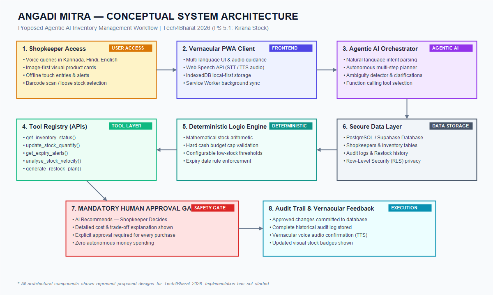
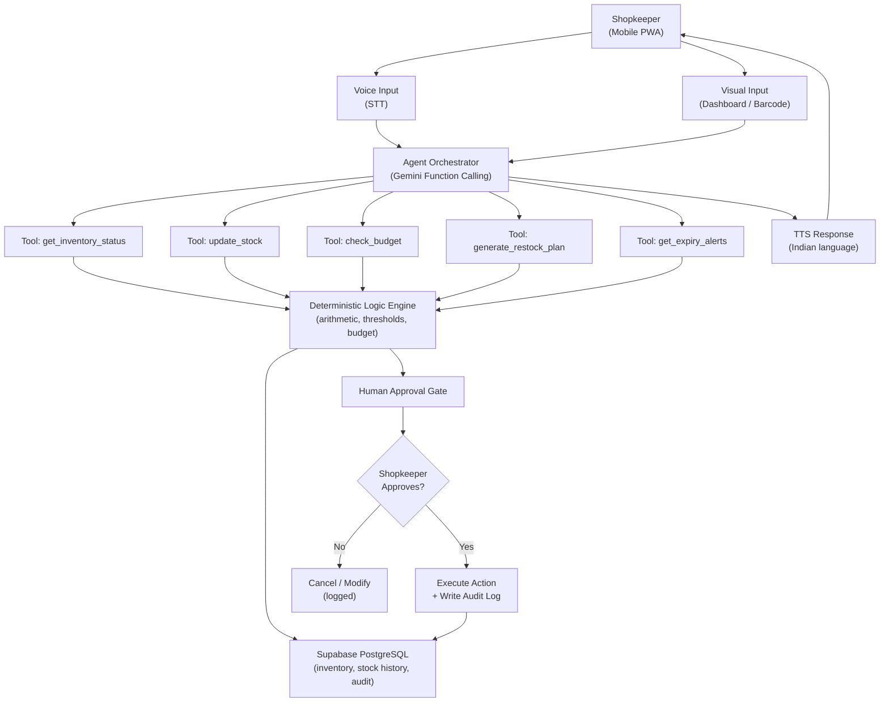

# Solution Architecture — Angadi Mitra

> **Status:** Proposed architecture — implementation not yet started.
> **Last updated:** November 2026

---

## 1. System Overview

Angadi Mitra is designed as a **Progressive Web App (PWA)** with an agentic AI backend. The architecture is intentionally layered so that each layer has a clear and limited responsibility.

### Conceptual Architecture Diagram


### End-to-End Conceptual Workflow Sequence:
```
Shopkeeper (Voice / Touch / Barcode)
   │
   ▼
Multilingual Frontend (Mobile PWA / Offline IndexedDB)
   │
   ▼
Agentic AI Orchestration (Intent Recognition & Multi-Step Planner)
   │
   ▼
Inventory & Analysis Tools (APIs: stock, velocity, expiry, budget)
   │
   ▼
Deterministic Logic Engine (Exact stock arithmetic & budget cap enforcement)
   │
   ▼
Database & Local Cache (PostgreSQL / Supabase RLS)
   │
   ▼
MANDATORY HUMAN APPROVAL GATE (AI Recommends — Shopkeeper Decides)
   │
   ▼
Audit Log Record & Spoken Vernacular Audio Confirmation
```

```
┌────────────────────────────────────────────────────────────┐
│                    SHOPKEEPER INTERFACE                     │
│          (Mobile PWA — Android entry-level devices)        │
│                                                            │
│  ┌──────────────┐  ┌──────────────┐  ┌──────────────────┐  │
│  │ Image-First  │  │  Voice Input │  │  Notifications   │  │
│  │  Dashboard   │  │  (STT/TTS)   │  │  & Alerts        │  │
│  └──────────────┘  └──────────────┘  └──────────────────┘  │
└────────────────────────────────────────────────────────────┘
                            │
                    (HTTPS / REST / WebSocket)
                            │
┌────────────────────────────────────────────────────────────┐
│                  BACKEND SERVICES LAYER                     │
│                                                            │
│  ┌──────────────┐  ┌──────────────┐  ┌──────────────────┐  │
│  │ Auth Service │  │  Inventory   │  │   Stock History  │  │
│  │ (Supabase)   │  │  API         │  │   & Audit Log    │  │
│  └──────────────┘  └──────────────┘  └──────────────────┘  │
│                                                            │
│  ┌──────────────────────────────────────────────────────┐  │
│  │              AGENT ORCHESTRATION LAYER               │  │
│  │                                                      │  │
│  │  ┌──────────────┐    ┌──────────────────────────┐   │  │
│  │  │ LLM (Gemini) │ ←→ │  Tool Registry           │   │  │
│  │  │ Function     │    │  (inventory, budget,      │   │  │
│  │  │ Calling      │    │   analysis, alerts)       │   │  │
│  │  └──────────────┘    └──────────────────────────┘   │  │
│  │                                                      │  │
│  │  ┌──────────────────────────────────────────────┐   │  │
│  │  │  Deterministic Logic Engine                  │   │  │
│  │  │  (arithmetic, budget checks, thresholds)     │   │  │
│  │  └──────────────────────────────────────────────┘   │  │
│  └──────────────────────────────────────────────────────┘  │
└────────────────────────────────────────────────────────────┘
                            │
┌────────────────────────────────────────────────────────────┐
│                    DATA LAYER                               │
│                                                            │
│  ┌──────────────┐  ┌──────────────┐  ┌──────────────────┐  │
│  │ PostgreSQL   │  │  File/Image  │  │  Local IndexedDB │  │
│  │ (Supabase)   │  │  Storage     │  │  (offline cache) │  │
│  └──────────────┘  └──────────────┘  └──────────────────┘  │
└────────────────────────────────────────────────────────────┘
                            │
┌────────────────────────────────────────────────────────────┐
│                 EXTERNAL AI SERVICES                        │
│                                                            │
│  ┌──────────────┐  ┌──────────────┐  ┌──────────────────┐  │
│  │ Gemini API   │  │ Cloud STT    │  │  Cloud TTS       │  │
│  │ (LLM + FC)   │  │ (Indian lang)│  │  (Indian lang)   │  │
│  └──────────────┘  └──────────────┘  └──────────────────┘  │
└────────────────────────────────────────────────────────────┘
```

---

## 2. Core Architectural Principles

### 2.1 Separation of Concerns

The architecture deliberately separates three types of logic:

| Layer | Responsibility | Technology |
|---|---|---|
| **Deterministic Logic** | Arithmetic, budget checks, threshold validation | TypeScript functions |
| **AI/Agent Layer** | Understanding intent, planning, explaining | Gemini API (Function Calling) |
| **UI Layer** | Display, interaction, voice I/O | React PWA |

**Why this matters for a beginner team:**
- Bugs in inventory arithmetic are easy to find and fix
- LLM behaviour is isolated — it cannot directly modify inventory
- If the AI makes a mistake, the deterministic layer catches it

### 2.2 Human Approval Gate

Every consequential action — especially any purchase decision — must pass through a human approval step:

```
AI Recommendation
      ↓
Show to Shopkeeper (with explanation)
      ↓
Shopkeeper approves / rejects / modifies
      ↓
Only then: execute action + log it
```

The AI **never** places an order or modifies stock without explicit shopkeeper confirmation.

### 2.3 Offline-First Design

Kirana stores in villages may have intermittent connectivity. The PWA stores pending changes in IndexedDB and synchronises when connectivity returns, with duplicate prevention and conflict handling.

```
Online:  Frontend → Supabase (direct, real-time)
Offline: Frontend → IndexedDB → [reconnect] → Supabase (sync queue)
```

---

## 3. Database Schema (Proposed)

### Core Tables

```sql
-- Shopkeeper accounts
shopkeepers (
  id UUID PRIMARY KEY,
  phone_number TEXT UNIQUE,
  store_name TEXT,
  language_preference TEXT,       -- 'kn', 'hi', 'en', 'ta', etc.
  budget_default NUMERIC,
  created_at TIMESTAMPTZ,
  updated_at TIMESTAMPTZ
)

-- Product catalogue (can be shared across shopkeepers)
products (
  id UUID PRIMARY KEY,
  canonical_name TEXT,            -- Standard product name
  brand TEXT,
  category TEXT,
  barcode TEXT,
  image_url TEXT,
  unit TEXT,                      -- 'packet', 'kg', 'litre', etc.
  created_at TIMESTAMPTZ
)

-- Regional name aliases
product_aliases (
  id UUID PRIMARY KEY,
  product_id UUID REFERENCES products(id),
  alias TEXT,
  language TEXT,
  region TEXT
)

-- Each shopkeeper's inventory
inventory_items (
  id UUID PRIMARY KEY,
  shopkeeper_id UUID REFERENCES shopkeepers(id),
  product_id UUID REFERENCES products(id),
  local_name TEXT,                -- Shopkeeper's own name for the product
  current_quantity NUMERIC,
  unit TEXT,
  low_stock_threshold NUMERIC,
  purchase_price NUMERIC,
  selling_price NUMERIC,
  expiry_date DATE,               -- NULL if not applicable
  batch_number TEXT,
  updated_at TIMESTAMPTZ
)

-- Stock movement history (audit trail)
stock_movements (
  id UUID PRIMARY KEY,
  shopkeeper_id UUID REFERENCES shopkeepers(id),
  inventory_item_id UUID REFERENCES inventory_items(id),
  movement_type TEXT,             -- 'sale', 'purchase', 'adjustment', 'expiry_removal'
  quantity_change NUMERIC,        -- Positive = in, negative = out
  quantity_before NUMERIC,
  quantity_after NUMERIC,
  source TEXT,                    -- 'voice', 'manual', 'barcode', 'distributor'
  note TEXT,
  created_at TIMESTAMPTZ
)

-- Supplier/Distributor records
suppliers (
  id UUID PRIMARY KEY,
  shopkeeper_id UUID REFERENCES shopkeepers(id),
  name TEXT,
  contact TEXT,
  visit_schedule TEXT,
  notes TEXT
)

-- AI recommendations log
restock_recommendations (
  id UUID PRIMARY KEY,
  shopkeeper_id UUID REFERENCES shopkeepers(id),
  generated_at TIMESTAMPTZ,
  budget_limit NUMERIC,
  recommendation_json JSONB,      -- Full recommendation payload
  status TEXT,                    -- 'pending', 'approved', 'rejected', 'modified'
  shopkeeper_response_at TIMESTAMPTZ,
  approved_items_json JSONB
)

-- Agent action audit log
agent_actions (
  id UUID PRIMARY KEY,
  shopkeeper_id UUID REFERENCES shopkeepers(id),
  session_id UUID,
  action_type TEXT,
  input_text TEXT,                -- What the shopkeeper said/typed
  intent_identified TEXT,
  tools_called JSONB,
  result TEXT,
  approval_required BOOLEAN,
  approval_given BOOLEAN,
  created_at TIMESTAMPTZ
)
```

---

## 4. Frontend Architecture

### 4.1 Application Pages (Proposed)

```
/                   → Language selection (first visit) or Home
/login              → Phone-based authentication
/dashboard          → Image-first inventory overview
/inventory          → Full product list with filters
/product/:id        → Product detail and stock history
/add-product        → Add a new product
/voice              → Voice command interface
/restock            → AI restocking recommendations
/alerts             → Low-stock, expiry, dead-stock alerts
/distributor        → Record incoming stock from distributor
/settings           → Language, budget, thresholds, account
```

### 4.2 Key Component Design Principles

- **Large touch targets** — minimum 48px height for all buttons
- **High contrast** — WCAG AA minimum for text on backgrounds
- **Image-first** — product images are primary identifiers, not text codes
- **Minimal text entry** — voice and visual selection over keyboard
- **Confirmation screens** — always show what will be changed before saving
- **Regional-language labels** — product names shown in shopkeeper's chosen language

---

## 5. Offline Architecture

### 5.1 Sync Strategy

```
Write operations (offline):
  1. Write to IndexedDB with status = 'pending_sync'
  2. Add to sync queue
  3. Show optimistic UI to shopkeeper

On reconnect:
  1. Process sync queue in order
  2. For each item: attempt POST/PATCH to Supabase
  3. On success: mark as 'synced', update local record
  4. On conflict: surface to shopkeeper for resolution
  5. On failure: retry with exponential backoff
```

### 5.2 What Works Offline

| Feature | Offline Available | Notes |
|---|---|---|
| View current inventory | ✅ | From local IndexedDB cache |
| Update stock quantity | ✅ | Queued for sync |
| View low-stock alerts | ✅ | Based on local data |
| Voice commands | ✅ | Web Speech API (device) |
| Barcode scanning | ✅ | Device camera |
| AI recommendations | ❌ | Requires Gemini API |
| Sync new distributor stock | ✅ | Queued for sync |
| Cloud TTS | ❌ | Requires internet |

---

## 6. Security Considerations

- **No secrets in code or git** — All API keys via environment variables
- **Row Level Security (RLS)** — Supabase RLS ensures shopkeeper A cannot see shopkeeper B's data
- **Minimum data collection** — Only collect what is needed for inventory management
- **No customer personal data** — The app manages shop inventory, not customer identities
- **Audit log** — All AI-initiated actions logged with before/after states
- **Explicit consent** — Any optional data import (UPI, khata) requires explicit shopkeeper opt-in

---

## 7. Scalability Approach

This architecture is designed to start simple and scale:

| Phase | Architecture |
|---|---|
| **Prototype** | Supabase free tier, Gemini free tier, single region |
| **Pilot (100 shops)** | Supabase Pro, Gemini API pay-per-use |
| **Scale (10,000+ shops)** | Supabase + edge functions, caching layer, CDN for images |

---

## 8. Mermaid Architecture Diagram



---

*This document describes the proposed architecture. All diagrams represent design intent, not implemented code.*
